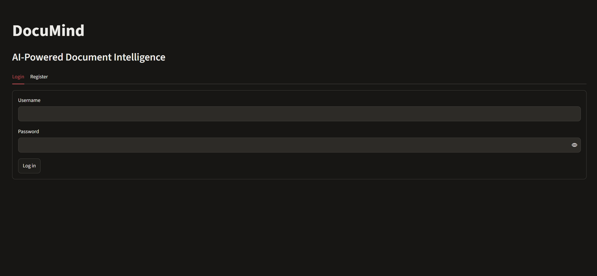
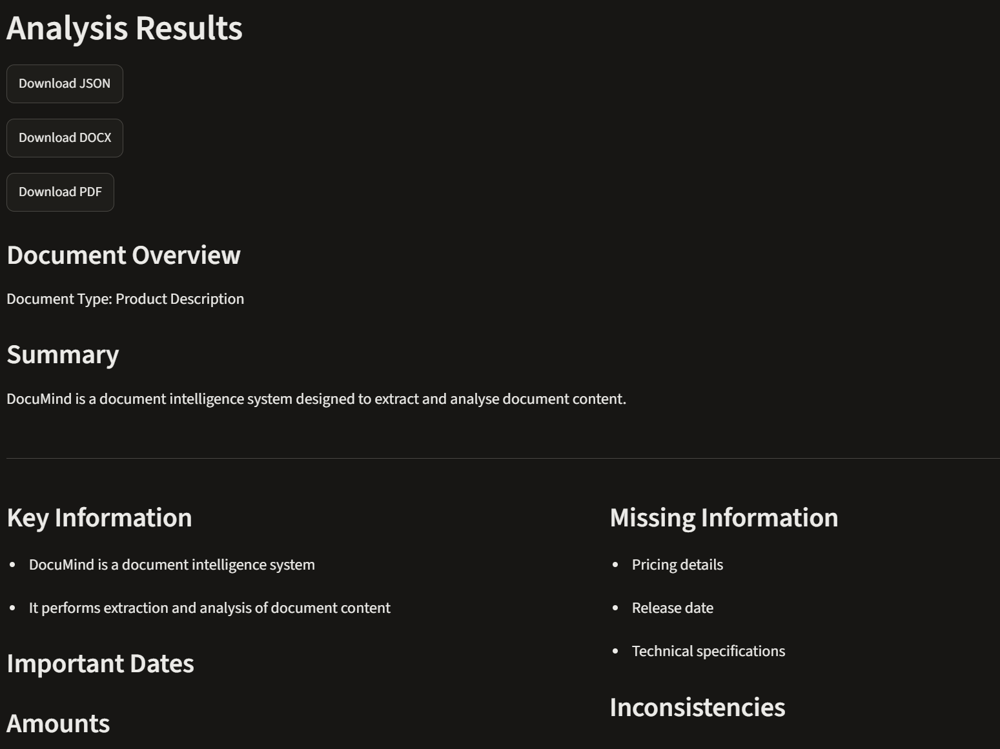
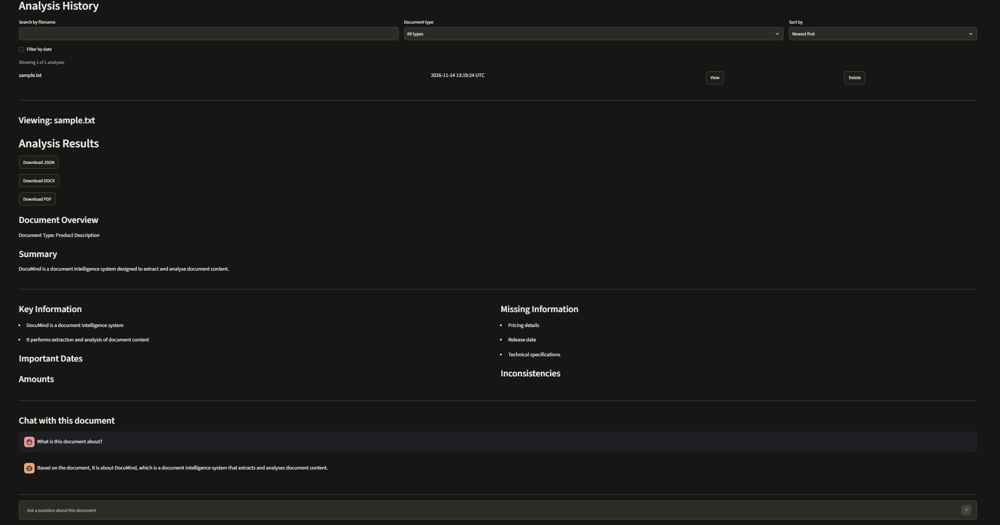
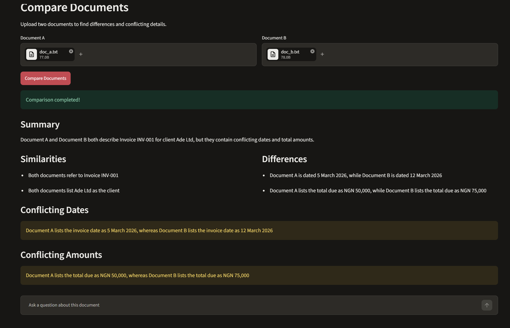

# DocuMind

AI-powered document intelligence. Upload a PDF, DOCX or TXT file and DocuMind uses Google Gemini to turn it into a structured analysis: document type, summary, key information, important dates, amounts, missing information and inconsistencies. You can then chat with the document, compare two documents, and export reports.

## Features

- Private user accounts (register, login, logout)
- Document analysis for PDF, DOCX and TXT files (10 MB limit)
- Analysis history with search, document-type filter, date filter and sorting
- Document preview before analysis
- Export results as JSON, DOCX or PDF
- Chat with a previously analysed document
- Compare two documents (similarities, differences, conflicting dates, amounts and information)

## Screenshots

**Login and registration**

**Document analysis**

**Chat with a document**

**Compare two documents**

## Tech stack

- Backend: FastAPI, Pydantic, PostgreSQL (Neon), SQLite fallback for local use and tests
- Frontend: Streamlit
- AI: Google Gemini via the google-genai SDK
- Auth: scrypt password hashing, signed tokens (itsdangerous)
- Tests: Pytest (Gemini is mocked, no API calls in tests)

## Architecture

    Streamlit frontend (frontend.py)
            |  HTTP + Bearer token
            v
    FastAPI backend (app/main.py)
        |-- auth.py              token creation and verification
        |-- rate_limit.py        login/register rate limiting
        |-- database.py          PostgreSQL/SQLite: users, document_analyses
        |-- services/
              |-- document_reader.py   content validation and text extraction
              |-- llm_service.py       Gemini analysis, chat, comparison

## Security

- Passwords hashed with scrypt and a per-user salt
- Signed tokens that expire after 24 hours
- Every history, chat and delete query is filtered by the owner's user id
- Uploads are validated by real file content, not just the extension
- Rate limiting on login and registration
- Prompt-injection mitigation: documents are wrapped in tags and treated as untrusted data
- Unexpected errors are logged server-side; users only see generic messages

## Getting started

Requirements: Python 3.13 and a Gemini API key.

1. Clone the repository and open the project folder.

2. Create and activate a virtual environment (PowerShell):

        python -m venv .venv
        .\.venv\Scripts\Activate.ps1

3. Install dependencies:

        pip install -r requirements.txt

4. Create a `.env` file in the project root (see `.env.example`):

        GEMINI_API_KEY=your-gemini-api-key
        SECRET_KEY=a-long-random-string

   Generate a SECRET_KEY with:

        python -c "import secrets; print(secrets.token_hex(32))"

5. Start the API (terminal 1):

        uvicorn app.main:app --reload

6. Start the frontend (terminal 2):

        streamlit run frontend.py

The frontend opens at http://localhost:8501 and the API docs are at http://127.0.0.1:8000/docs.

## API overview

| Method | Path | Auth | Purpose |
|---|---|---|---|
| POST | /register, /login | public | Create account or log in, returns a token |
| GET | /me | token | Current username |
| POST | /analyze | token | Analyse an uploaded document |
| GET | /history, /history/{id} | token | List or fetch your analyses |
| DELETE | /history/{id} | token | Delete one of your analyses |
| POST | /chat | token | Ask a question about a stored document |
| POST | /compare | token | Compare two uploaded documents |

## Running the tests

    python -m pytest

## Roadmap

- Token revocation and rate limits on the AI endpoints
